### Environment Variables Setup

[OPTION BEGIN [Python SDK]]

- Open **Visual Studio Code or Jupyter Notebook**. Create a new file with the `.ipynb` extension (e.g., `Tabular_AI_Predictions_With_Context_Registry.ipynb`).
- Create a **`.env`** file in the root directory of your project.
- Add your **AI Core** credentials as shown below.

```env
# AICORE CREDENTIALS
AICORE_CLIENT_ID=<AICORE CLIENT ID>
AICORE_CLIENT_SECRET=<AICORE CLIENT SECRET>
AICORE_AUTH_URL=<AICORE AUTH URL>
AICORE_BASE_URL=<AICORE BASE URL>
AICORE_RESOURCE_GROUP=<AICORE RESOURCE GROUP>

# TABULAR AI
TABULAR_MODEL_NAME=sap-rpt-1.5-large
TEST_PREFIX=<YOUR UNIQUE PREFIX>
HDL_FILE_PATH=/github-pipeline/used-cars-1m.csv
```

**Note:** Replace placeholders with your actual environment credentials. These values come from the **service key** of your AI Core service instance in the SAP BTP cockpit — the JSON service key contains `clientid`, `clientsecret`, the OAuth `url` (→ `AICORE_AUTH_URL`), and the API `serviceurls.AI_API_URL` (→ `AICORE_BASE_URL`).

⚠️ `AICORE_AUTH_URL` is the `*.authentication.*.hana.ondemand.com` host and `AICORE_BASE_URL` is the `api.ai.*.ml.hana.ondemand.com` host. Mixing the two produces a hostname that resolves but never completes a TLS handshake, which surfaces as an unhelpful "error occurred while executing the request".

#### Install Dependencies and Connect to AI Core

```python
%pip install --quiet requests pandas python-dotenv generative-ai-hub-sdk


import json
import os
import time
from typing import Any, Dict, Optional
import requests
import pandas as pd

with open("aicore-config.json", "r", encoding="utf-8") as f:
    config = json.load(f)

CLIENT_ID = config["clientid"]
CLIENT_SECRET = config["clientsecret"]
AUTH_URL = config["url"].rstrip("/")
BASE_URL = config["serviceurls"]["AI_API_URL"].rstrip("/")

RESOURCE_GROUP = os.getenv("AICORE_RESOURCE_GROUP", "default")
MODEL_NAME = os.getenv("TABULAR_MODEL_NAME", "sap-rpt-1.5-large")
DATA_PATH = "/github-pipeline/used-cars-1m.csv"

PREFIX = os.getenv("TEST_PREFIX", "canary-eu10-2607a")
DEST_NAME = f"{PREFIX}-platform-test-dd"
ARTIFACT_NAME = f"{PREFIX}-platform-test-ta"
SCENARIO_CONFIG_NAME = f"{PREFIX}-platform-test-sc"

print("=" * 80)
print("SAP AI CORE CONFIGURATION")
print("=" * 80)
print("AI Core URL    :", BASE_URL)
print("Resource Group :", RESOURCE_GROUP)
print("Model          :", MODEL_NAME)
print("Dataset        :", DATA_PATH)
print("Data Destination:", DEST_NAME)
print("Tabular Artifact :", ARTIFACT_NAME)
print("Scenario Config  :", SCENARIO_CONFIG_NAME)


def get_token():
    r = requests.post(
        f"{AUTH_URL}/oauth/token",
        auth=(CLIENT_ID, CLIENT_SECRET),
        data={"grant_type": "client_credentials"},
        timeout=30,
    )
    r.raise_for_status()
    return r.json()["access_token"]

TOKEN = get_token()

HEADERS = {
    "Authorization": f"Bearer {TOKEN}",
    "Content-Type": "application/json",
    "AI-Resource-Group": RESOURCE_GROUP,
    "x-aicore-service-plan": "sap-internal",
}

print("Authentication successful.")


LM = f"{BASE_URL}/v2/lm"
TCR = f"{BASE_URL}/v2/tcr"

def parse_response(r):
    try:
        return r.json()
    except ValueError:
        return r.text

def call(method, url, payload=None, expected=(200, 201, 202, 204)):
    r = requests.request(method, url, headers=HEADERS, json=payload, timeout=120)
    body = parse_response(r)
    if r.status_code not in expected:
        print(f"!! {method} {url}")
        print("!! status:", r.status_code)
        print(json.dumps(body, indent=2) if isinstance(body, (dict, list)) else repr(body))
    return body

TCR_HEADERS = {"Content-Type": "application/json"}

def tcr_call(method, url, payload=None, expected=(200, 201, 202, 204, 409)):
    r = requests.request(method, url, headers=TCR_HEADERS, json=payload, timeout=120)
    body = parse_response(r)
    if r.status_code not in expected:
        print(f"!! TCR {method} {url}")
        print("!! status:", r.status_code)
        print("!! response headers:", dict(r.headers))
        print(json.dumps(body, indent=2) if isinstance(body, (dict, list)) else repr(body))
    return r.status_code, body

def show(obj, limit=4000):
    text = json.dumps(obj, indent=2) if isinstance(obj, (dict, list)) else str(obj)
    print(text[:limit] + ("..." if len(text) > limit else ""))
```
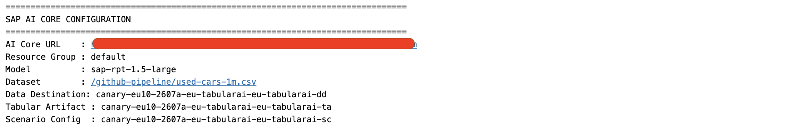
[OPTION END]

[OPTION BEGIN [Bruno]]

Open the `TabularAI` collection in Bruno and select your environment. The environment holds:

| Variable | Source |
|---|---|
| `clientid` | AI Core service key |
| `clientsecret` | AI Core service key (stored as a secret, so it is not shipped with the collection) |
| `auth_url` | service key `url` |
| `ai_api_url` | service key `serviceurls.AI_API_URL` |
| `test_prefix` | your unique prefix for object names |
| `bearer_token` | written automatically by `GET Bearer Token` |
| `deployment_id` | written automatically by `POST Create Virtual Deployment` |

Run **`GET Bearer Token`** first:

```bash
POST {{auth_url}}/oauth/token?grant_type=client_credentials
```

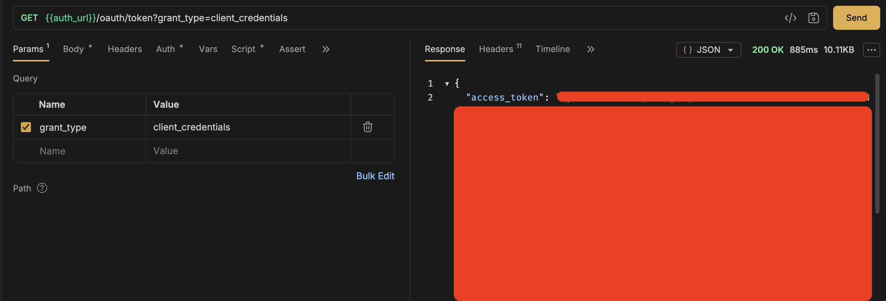

Use Basic auth with `clientid` / `clientsecret`. Its post-response script writes `bearer_token` into the environment. Tokens expire after a few hours — rerun this request whenever other requests start returning `401`.

💡 Do not add an `Authorization` header manually anywhere in the collection. Set the request's **Auth** tab to Bearer with `{{bearer_token}}` and let Bruno build the header; adding both produces a malformed value and an authentication-format error.

[OPTION END]

---

### Create a Configuration and Virtual Deployment

[OPTION BEGIN [Python SDK]]

Look up the scenario, create a configuration for it, then create a virtual deployment and wait for it to run:

```python
scenario = call("GET", f"{LM}/scenarios/tabular-orchestration")
show(scenario)

if not isinstance(scenario, dict) or scenario.get("id") != "tabular-orchestration":
    raise RuntimeError("tabular-orchestration scenario was not found.")

executables = call("GET", f"{LM}/scenarios/tabular-orchestration/executables")
items = executables.get("resources", executables) if isinstance(executables, dict) else executables

for ex in items or []:
    print(ex.get("id"), "|", ex.get("name"))

if not any(ex.get("id") == "tabular-orchestration" for ex in (items or [])):
    raise RuntimeError("tabular-orchestration executable was not found.")


config_body = {
    "name": f"{PREFIX}-tabular-config",
    "executableId": "tabular-orchestration",
    "scenarioId": "tabular-orchestration",
    "parameterBindings": [
        {"key": "modelName", "value": MODEL_NAME}
    ],
}

configuration = call("POST", f"{LM}/configurations", config_body)

if not isinstance(configuration, dict) or not configuration.get("id"):
    raise RuntimeError("Configuration creation failed:
" + str(configuration))

configuration_id = configuration["id"]
print("configuration_id:", configuration_id)


deployment = call(
    "POST",
    f"{LM}/deployments",
    {"configurationId": configuration_id},
)

if not isinstance(deployment, dict) or not deployment.get("id"):
    raise RuntimeError("Deployment response has no id:
" + str(deployment))

deployment_id = deployment["id"]
print("deployment_id:", deployment_id)

DEPLOYMENT_URL = ""

for attempt in range(120):
    current = call("GET", f"{LM}/deployments/{deployment_id}")

    if not isinstance(current, dict):
        print(f"[{attempt+1:03d}] unexpected response:", current)
        time.sleep(10)
        continue

    status = str(current.get("status", "")).upper()
    print(f"[{attempt+1:03d}] Deployment status: {status or 'UNKNOWN'}")

    if status == "RUNNING":
        DEPLOYMENT_URL = (current.get("deploymentUrl") or "").rstrip("/")
        if DEPLOYMENT_URL:
            break
        print("RUNNING but deploymentUrl is not available yet.")
    elif status in {"DEAD", "STOPPED"}:
        raise RuntimeError(
            "Deployment failed:
" + json.dumps(current, indent=2)
        )

    time.sleep(10)

if not DEPLOYMENT_URL:
    raise TimeoutError("Deployment did not become RUNNING with a deploymentUrl.")

print("Deployment URL:", DEPLOYMENT_URL)
```
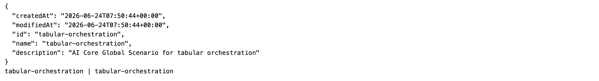

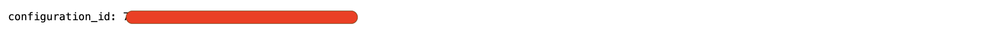

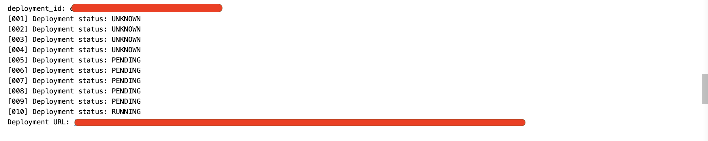

A `404` on the scenario means Tabular AI is not available in this landscape — stop here, because nothing downstream will work.

[OPTION END]

[OPTION BEGIN [Bruno]]

Run the requests in the **`1. AI Core`** folder in order.

**1. GET Scenario - tabular-orchestration** — expect `200`. A `404` means Tabular AI is not available in this landscape, so stop here.

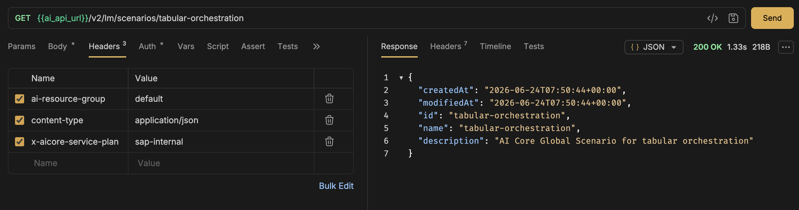

**2. GET Executables - tabular-orchestration** — expect `200` with the executable list.

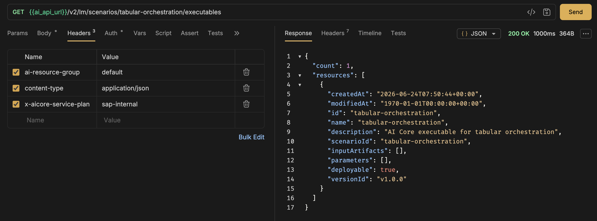

**3. POST Create Configuration** — expect `201`. Copy the returned `id`.

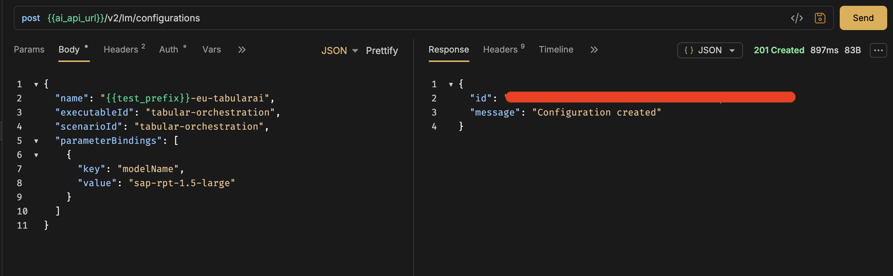

**4. POST Create Virtual Deployment** — expect `201`. Its post-response script writes `deployment_id` into the environment.

**Body (JSON):**

```json
{
  "configurationId": "<id from step 3>"
}
```

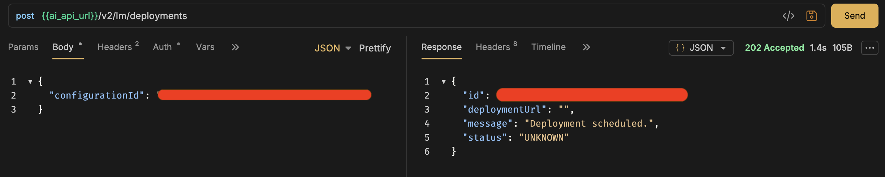

**5. GET Virtual Deployment status** — poll until the status is `RUNNING`.

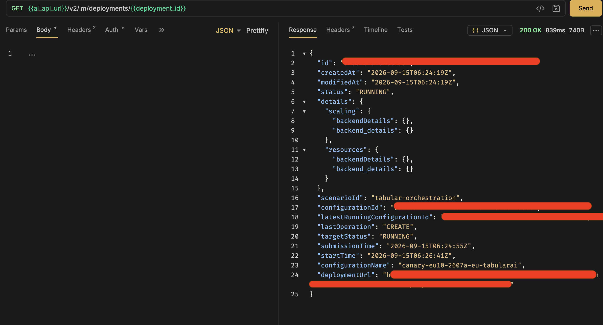

💡 The collection ships with a hardcoded `configurationId` and a leftover `deployment_id` from whoever exported it. Replace the `configurationId` with the one you created in step 3, and let step 4 overwrite `deployment_id`. Predictions against a deployment that is not yet `RUNNING` will fail.

[OPTION END]

---

### Register the Data Destination

[OPTION BEGIN [Python SDK]]

The data destination tells the Context Registry where your dataset lives:

```python
# ============================================================
# TCR REQUEST HELPER
# TCR is called separately from normal AI Core APIs.
# Do NOT reuse HEADERS here.
# ============================================================

TCR_HEADERS = {
    "Authorization": f"Bearer {TOKEN}",
    "Content-Type": "application/json",
    "AI-Resource-Group": RESOURCE_GROUP,
    "x-aicore-service-plan": "sap-internal"
}


def tcr_call(method, url, payload=None, expected=(200, 201, 202, 204, 409)):
    resp = requests.request(
        method,
        url,
        headers=TCR_HEADERS,
        json=payload,
        timeout=120,
    )

    try:
        body = resp.json()
    except ValueError:
        body = resp.text

    print(f"{method} {url}")
    print("Status:", resp.status_code)
    print("Response headers:", dict(resp.headers))

    if body:
        print("Response:")
        print(
            json.dumps(body, indent=2)
            if isinstance(body, (dict, list))
            else repr(body)
        )

    return resp.status_code, body

DEST_NAME = "canary-eu10-2607a-platform-test-dd"

dest_url = f"{TCR}/dataDestinations/{DEST_NAME}"

dest_body = {
    "type": "HDL",
    "adapterType": "File",
    "config": {
        "host": "28dxxxxxxxyyyyyyyyy8d5d8e8.files.hdl.canary-eu10.hanacloud.ondemand.com"
    }
}

status, body = tcr_call(
    "PUT",
    dest_url,
    dest_body
)

print("
PUT status:", status)

if status not in (200, 201, 202, 204, 409):
    raise RuntimeError(
        f"Data Destination registration failed with HTTP {status}"
    )
```
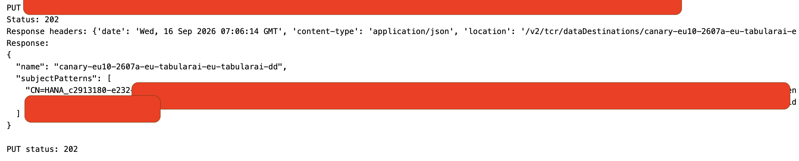

[OPTION END]

[OPTION BEGIN [Bruno]]

Run **`2. Context Registry (Pre-step)` → `1. Register Data Destination`**, then **`1b. Get Data Destination status`** and wait until it reports a ready state.

**URL:**

```bash
PUT {{ai_api_url}}/v2/admin/tcr/dataDestinations/{{test_prefix}}-platform-test-dd
```

**Headers:**

```
Authorization: Bearer {{bearer_token}}
Content-Type: application/json
AI-Resource-Group: default
x-aicore-service-plan: sap-internal
```

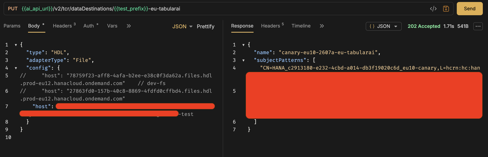

Read the destination back to check its status:

```bash
GET {{ai_api_url}}/v2/admin/tcr/dataDestinations/{{test_prefix}}-platform-test-dd
```

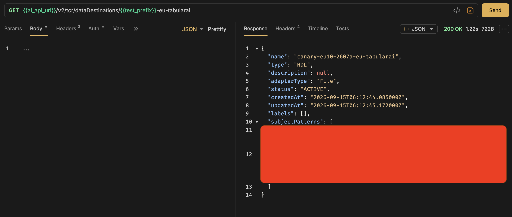

💡 A `RBAC: access denied` here means your credentials or resource group lack Context Registry permissions — check the `AI-Resource-Group` and `x-aicore-service-plan` headers against a working request before assuming the URL is wrong.

[OPTION END]

---
### Subject Pattern Configuration in HANA Data Lake

If the resource group certificate is not yet registered in the HANA Data Lake Files instance, configure the subject patterns before registering the Tabular Artifact.

**1. Go to the HANA Data Lake Files instance in SAP HANA Cloud Central and click `Manage Configuration`.**

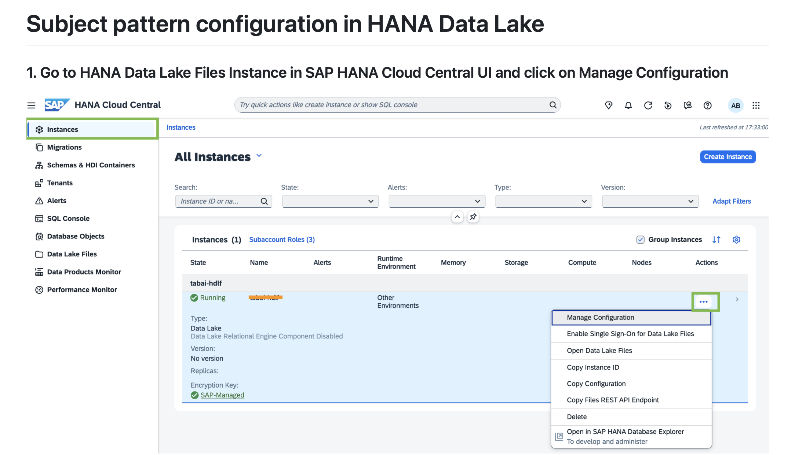

**2. Click the `Data Lake Files` tab.**

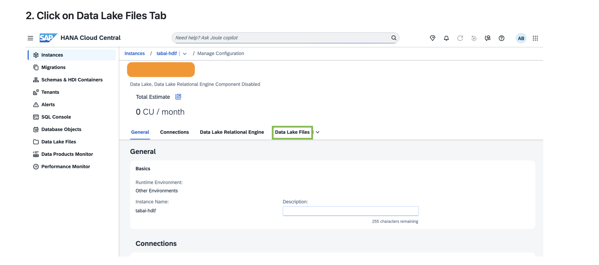

**3. Go to `Authorizations` and create the required User Role Authorizations, ensuring that the subject patterns are filled in.**

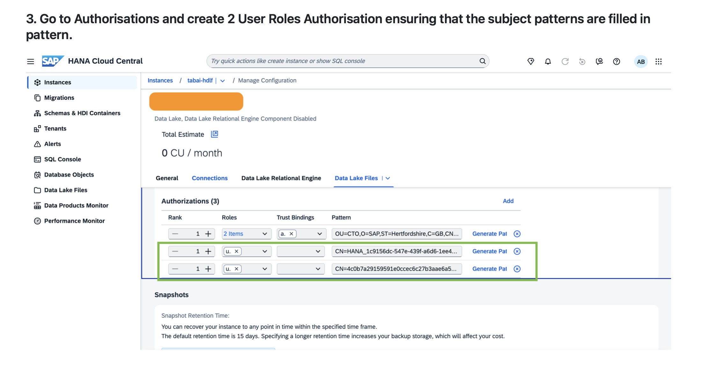
10. Free deployment capacity in the resource group. Virtual deployments count against the deployment quota, so clean up unused deployments before starting.

---

### Register the Tabular Artifact

[OPTION BEGIN [Python SDK]]

The artifact points at the specific file within the destination and declares its schema:

```python
CSN_ELEMENTS = {
    "idx": {"type": "cds.Integer"},
    "Car Brand": {"type": "cds.String"},
    "Model": {"type": "cds.String"},
    "Price": {"type": "cds.Integer"},
    "Model Year": {"type": "cds.Integer"},
    "Location": {"type": "cds.String"},
    "Fuel": {"type": "cds.String"},
    "Driven (Kms)": {"type": "cds.Integer"},
    "Gear": {"type": "cds.String"},
    "Ownership": {"type": "cds.Integer"},
    "EMI (monthly)": {"type": "cds.Integer"}
}

artifact_body = {
    "dataDestinationName": DEST_NAME,
    "type": "CSV",
    "path": DATA_PATH,
    "csnMetadata": {
        "entityName": "CarEntity",
        "selectedColumns": list(CSN_ELEMENTS.keys()),
        "definition": {
            "definitionType": "DOCUMENT",
            "document": {
                "definitions": {
                    "CarEntity": {
                        "kind": "entity",
                        "elements": CSN_ELEMENTS
                    }
                }
            }
        }
    }
}

artifact_url = f"{TCR}/tabularArtifacts/{ARTIFACT_NAME}"

status, body = tcr_call(
    "PUT",
    artifact_url,
    artifact_body,
    expected=(200, 201, 202, 204, 409),
)

print("PUT status:", status)
show(body)

if status not in (200, 201, 202, 204, 409):
    raise RuntimeError("Tabular Artifact registration failed.")

status, verified = tcr_call("GET", artifact_url, expected=(200, 201, 202))
print("GET status:", status)
show(verified)

if status != 200:
    raise RuntimeError("Tabular Artifact could not be verified.")
```
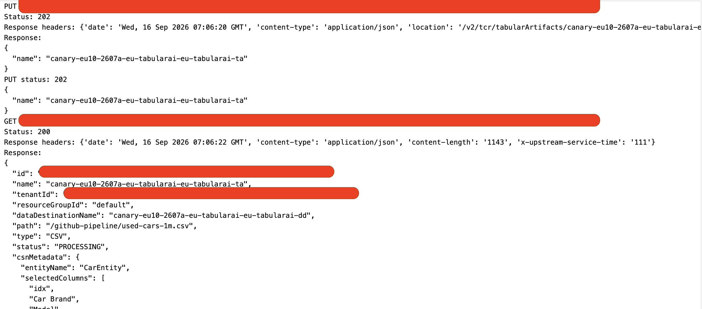
[OPTION END]

[OPTION BEGIN [Bruno]]

Run **`2. Register Tabular Artifact`**, then **`2b. Get Tabular Artifact status`** until it reports registered.

**URL:**

```bash
PUT {{ai_api_url}}/v2/admin/tcr/tabularArtifacts/{{test_prefix}}-platform-test-ta
```

**Body (JSON):**

```json
{
  "dataDestinationName": "{{test_prefix}}-platform-test-dd",
  "type": "CSV",
  "path": "/github-pipeline/used-cars-1m.csv",
  "csnMetadata": {
    "entityName": "CarEntity",
    "selectedColumns": [
      "idx",
      "Car Brand",
      "Model",
      "Price",
      "Model Year",
      "Location",
      "Fuel",
      "Driven (Kms)",
      "Gear",
      "Ownership",
      "EMI (monthly)"
    ],
    "definition": {
      "definitionType": "DOCUMENT",
      "document": {
        "definitions": {
          "CarEntity": {
            "kind": "entity",
            "elements": {
              "idx": { "type": "cds.Integer" },
              "Car Brand": { "type": "cds.String" },
              "Model": { "type": "cds.String" },
              "Price": { "type": "cds.Integer" },
              "Model Year": { "type": "cds.Integer" },
              "Location": { "type": "cds.String" },
              "Fuel": { "type": "cds.String" },
              "Driven (Kms)": { "type": "cds.Integer" },
              "Gear": { "type": "cds.String" },
              "Ownership": { "type": "cds.Integer" },
              "EMI (monthly)": { "type": "cds.Integer" }
            }
          }
        }
      }
    }
  }
}
```

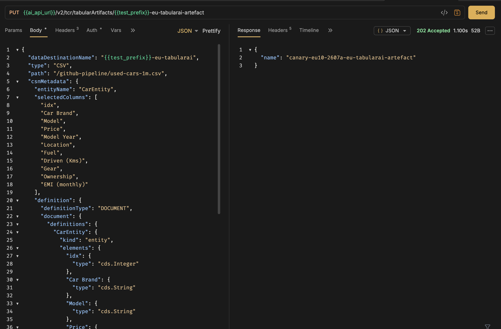

Check the registration status:

```bash
GET {{ai_api_url}}/v2/admin/tcr/tabularArtifacts/{{test_prefix}}-platform-test-ta
```

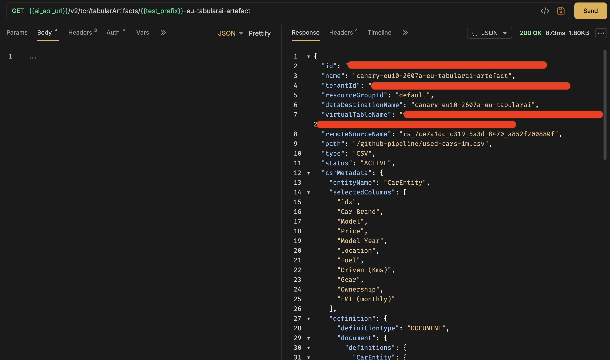

Two errors are common at this step, and they mean different things:

```json
{
  "error": {
    "code": "401",
    "message": "Access denied to file path '...' in HDL for tabular artifact '...'. The subject pattern for resource group (Subject DN: ...) may not be registered in HDL."
  }
}
```

Your resource group's certificate is not authorized in the HDL instance. This cannot be fixed from the collection — send the full `Subject DN` from the error, your resource group name, the file path, and the `requestId` to whoever administers that HDL instance so they can register the subject pattern.

```json
{
  "error": {
    "code": "400",
    "message": "File path '/used-cars/used-cars-1m.csv' does not exist in HDL for tabular artifact '...'"
  }
}
```

Access works, but the file is not at that path — correct `path` and re-register. If the artifact name already exists from the failed attempt, delete it first using the request in the `Others` folder.

[OPTION END]

---

### Register the Scenario Configuration

[OPTION BEGIN [Python SDK]]

The scenario configuration is the named object that prediction requests reference:

```python
scm_body = {
    "tabularArtifacts": [
        {
            "name": ARTIFACT_NAME
        }
    ]
}

scenario_config_url = f"{TCR}/scenarioConfigurations/{SCENARIO_CONFIG_NAME}"

status, body = tcr_call(
    "PUT",
    scenario_config_url,
    scm_body,
    expected=(200, 201, 202, 204, 409),
)

print("PUT status:", status)
show(body)

if status not in (200, 201, 202, 204, 409):
    raise RuntimeError("Scenario Configuration registration failed.")
```
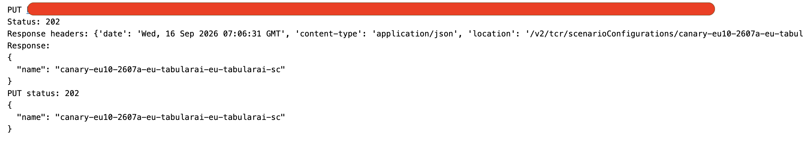
[OPTION END]

[OPTION BEGIN [Bruno]]

Run **`3. Register Scenario Configurations`**, then **`3b. Get Scenario Configuration status`** until it is ready.

**URL:**

```bash
PUT {{ai_api_url}}/v2/admin/tcr/scenarioConfigurations/{{test_prefix}}-platform-test-scm
```

A successful create returns the object name:

```json
{
  "name": "canary-eu10-2607a-platform-test-scm"
}
```

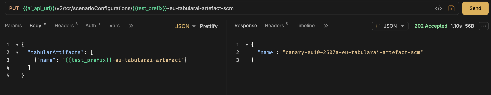

Check the status:

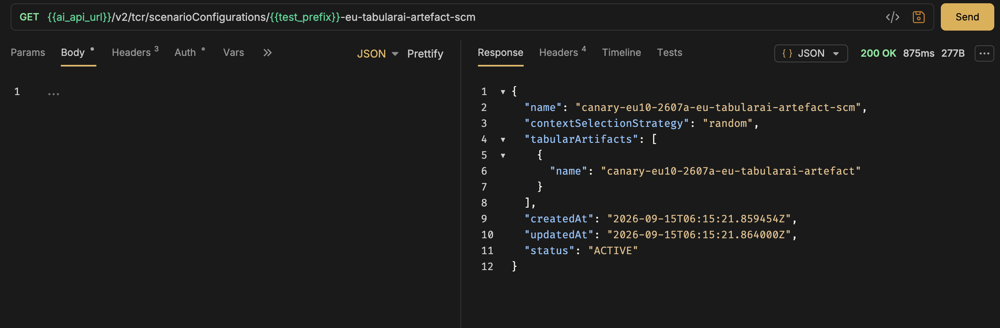

💡 This name must match the `scenarioConfigName` used by the prediction requests, which is built from `{{test_prefix}}`. If you change `test_prefix` between registration and prediction, the prediction will fail to find the configuration.

[OPTION END]

---

### Run Predictions

[OPTION BEGIN [Python SDK]]

Send a small table with the cells to predict marked `[PREDICT]`, and declare those columns in `targetColumns`:

```python
PREDICT_URL = f"{BASE_URL}/v2/inference/deployments/{deployment_id}/predict"

QUERY_COLUMNS = {
    "Car Brand": ["Hyundai", "Maruti", "Tata"],
    "Model": ["EonERA", "Wagon R 1.0LXI", "Alto K10LXI"],
    "Price": ["330399", "350199", "229199"],
    "Model Year": ["2016", "2011", "2011"],
    "Location": ["[PREDICT]", "[PREDICT]", "[PREDICT]"],
    "Fuel": [
    "[PREDICT]",
    "Petrol",
    "Petrol"
]
}
PREDICT_HEADERS = {
    "Authorization": f"Bearer {TOKEN}",
    "AI-Resource-Group": RESOURCE_GROUP,
    "Content-Type": "application/json",
    
}
TARGET_COLUMNS = [{
    "name": "Location",
    "predictionPlaceholder": "[PREDICT]",
    "taskType": "classification"
}]

def build_payload(context_config=None, columns=None, target_columns=None):
    payload = {
        "modelName": MODEL_NAME,
        "scenarioConfigName": SCENARIO_CONFIG_NAME,
        "predictionConfig": {
            "targetColumns": target_columns or TARGET_COLUMNS
        },
        "columns": columns or QUERY_COLUMNS
    }
    if context_config is not None:
        payload["contextSelectionConfig"] = context_config
    return payload

result = requests.post(
    PREDICT_URL,
    headers=PREDICT_HEADERS,
    json=build_payload({"strategy": "random"}),
    timeout=120,
)

print("Status:", result.status_code)
print("Response:", result.text)

show(result)
```
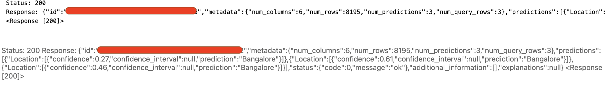


### Summarize Predictions:

def summarize(result, column="Location"):

    if hasattr(result, "json"):
        result = result.json()

    if not isinstance(result, dict) or "predictions" not in result:
        print("No predictions:", str(result)[:500])
        return

    meta = result.get("metadata", {})

    print(
        "context rows:", meta.get("num_rows"),
        "| query rows:", meta.get("num_query_rows")
    )

    for i, row in enumerate(result["predictions"]):
        for cand in row.get(column, []):
            print(
                f"row {i}: {cand.get('prediction')} "
                f"(confidence {cand.get('confidence')})"
            )
summarize(result)
```
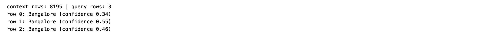

[OPTION END]

[OPTION BEGIN [Bruno]]

Run **`3. Tabular Orchestration` → `1. Get predictions`**.

**URL:**

```bash
POST {{ai_api_url}}/v2/inference/deployments/{{deployment_id}}/predict
```

**Body (JSON):**

```json
{
  "modelName": "{{modelName}}",
  "scenarioConfigName": "{{test_prefix}}-platform-test-scm",
  "contextSelectionConfig": {
    "strategy": "random"
  },
  "predictionConfig": {
    "targetColumns": [
      {
        "name": "Location",
        "predictionPlaceholder": "[PREDICT]",
        "taskType": "classification"
      }
    ]
  },
  "columns": {
    "Car Brand":  ["Hyundai", "Maruti", "Tata"],
    "Model":      ["EonERA", "Wagon R 1.0LXI", "Alto K10LXI"],
    "Price":      ["330399", "350199", "229199"],
    "Model Year": ["2016", "2011", "2011"],
    "Location":   ["[PREDICT]", "[PREDICT]", "[PREDICT]"],
    "Fuel":       ["Petrol", "Petrol", "Petrol"]
  }
}
```

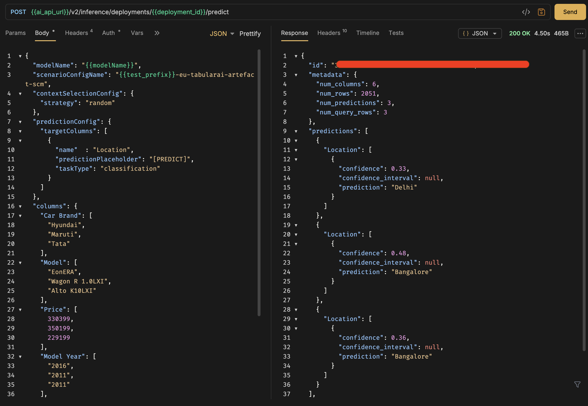

`modelName` comes from the folder-level variable — change it there (right-click the folder → **Settings** → **Vars**) to try a different tabular model, for example a smaller `sap-rpt` variant.

[OPTION END]

---

### Compare Context Selection Strategies

[OPTION BEGIN [Python SDK]]

Only `contextSelectionConfig` changes between runs, so sweep it:

```python
STRATEGIES = [
    ("random (default)", {"strategy": "random"}),
    ("random, 100 rows", {"strategy": "random", "numRows": 100}),
    ("random, 100000 rows", {"strategy": "random", "numRows": 100000}),
    ("heuristic", {"strategy": "heuristic", "indexColumn": "idx"}),
    ("auto", {"strategy": "auto"}),
]

runs = {}

for label, cfg in STRATEGIES:
    print(f"=== {label} ===")
    out = call(
        "POST",
        PREDICT_URL,
        build_payload(cfg),
        expected=(200, 201, 400, 500)
    )
    runs[label] = out
    summarize(out)
    print()
```
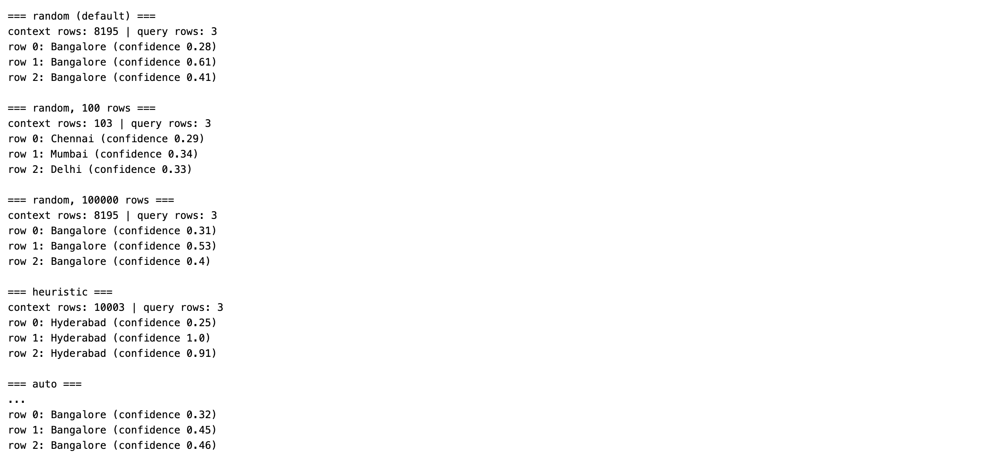

### Top K Predictions:
```python
topk_targets = [{
    "name": "Location",
    "predictionPlaceholder": "[PREDICT]",
    "taskType": "classification",
    "topK": 3
}]

topk_result = call(
    "POST",
    PREDICT_URL,
    build_payload({"strategy": "random"}, target_columns=topk_targets),
    expected=(200, 201, 400, 500)
)

summarize(topk_result)
```
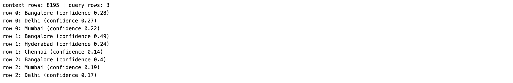
```python
INLINE_COLUMNS = {
    "Car Brand": ["Hyundai", "Maruti", "Tata", "Hyundai", "Maruti"],
    "Model": ["EonERA", "Wagon R 1.0LXI", "Alto K10LXI", "EonERA", "Wagon R 1.0LXI"],
    "Price": ["330399", "350199", "229199", "330399", "350199"],
    "Model Year": ["2016", "2011", "2011", "2016", "2011"],
    "Location": ["[PREDICT]", "[PREDICT]", "[PREDICT]", "Hyderabad", "Hyderabad"],
    "Fuel": ["Petrol", "Petrol", "Petrol", "Petrol", "Petrol"]
}

inline = call(
    "POST",
    PREDICT_URL,
    build_payload({"strategy": "none"}, columns=INLINE_COLUMNS),
    expected=(200, 201, 400, 500)
)

runs["none, inline context"] = inline
summarize(inline)
```
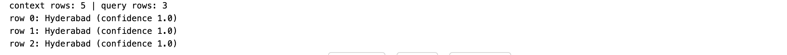

### Side By Side Comparison:
```python
rows = []

for label, out in runs.items():
    if not isinstance(out, dict) or "predictions" not in out:
        rows.append({"strategy": label, "context rows": None, "result": "failed"})
        continue

    meta = out.get("metadata", {})

    for i, pred in enumerate(out["predictions"]):
        top = (pred.get("Location") or [{}])[0]
        rows.append({
            "strategy": label,
            "context rows": meta.get("num_rows"),
            "query row": i,
            "prediction": top.get("prediction"),
            "confidence": top.get("confidence")
        })

comparison = pd.DataFrame(rows)
display(comparison)

if "prediction" in comparison.columns:
    summary = (
        comparison
        .groupby("strategy")
        .agg(
            context_rows=("context rows", "first"),
            distinct_predictions=("prediction", "nunique"),
            mean_confidence=("confidence", "mean")
        )
        .sort_values("mean_confidence", ascending=False)
    )
    display(summary)
```
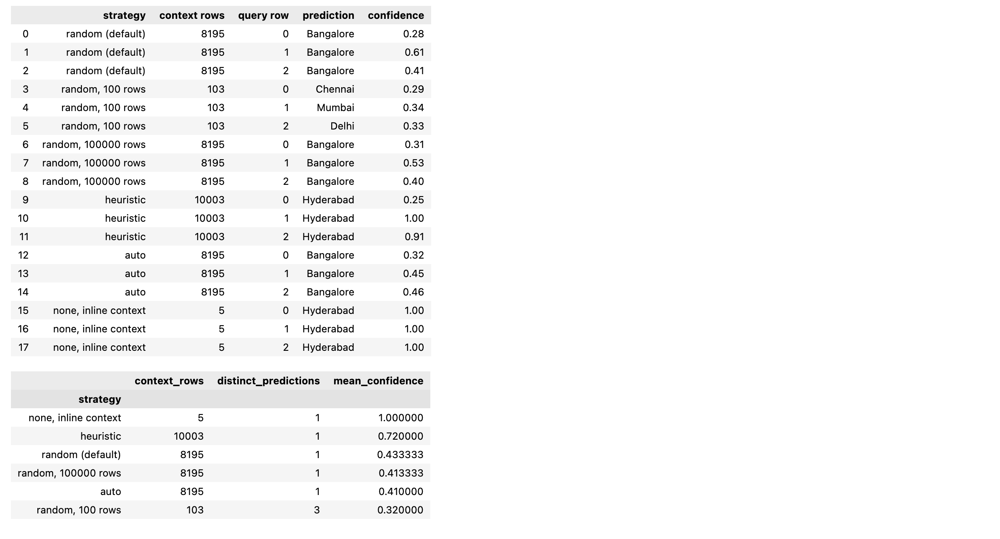
What to look for: retrieval-aware strategies should produce more differentiated predictions and higher confidence than `random`. If they do not, the retrieval is not adding value for this query set — which is itself a useful result.

[OPTION END]

[OPTION BEGIN [Bruno]]

The numbered requests in **`3. Tabular Orchestration`** each set a different `contextSelectionConfig`. They all use the same URL — only the body changes:

```bash
POST {{ai_api_url}}/v2/inference/deployments/{{deployment_id}}/predict
```

#### 1. Random strategy, extra placeholder in an undeclared column

`Fuel` contains a `[PREDICT]` but is not listed in `targetColumns`, so it is returned untouched.

```json
{
  "modelName": "{{modelName}}",
  "scenarioConfigName": "{{test_prefix}}-platform-test-scm",
  "contextSelectionConfig": {
    "strategy": "random"
  },
  "predictionConfig": {
    "targetColumns": [
      {
        "name": "Location",
        "predictionPlaceholder": "[PREDICT]",
        "taskType": "classification"
      }
    ]
  },
  "columns": {
    "Car Brand":  ["Hyundai", "Maruti", "Tata"],
    "Model":      ["EonERA", "Wagon R 1.0LXI", "Alto K10LXI"],
    "Price":      [330399, 350199, 229199],
    "Model Year": ["2016", "2011", "2011"],
    "Location":   ["[PREDICT]", "[PREDICT]", "[PREDICT]"],
    "Fuel":       ["[PREDICT]", "Petrol", "Petrol"]
  }
}
```


#### 2. Random strategy with a small context (`numRows: 100`)

```json
{
  "modelName": "{{modelName}}",
  "scenarioConfigName": "{{test_prefix}}-platform-test-scm",
  "contextSelectionConfig": {
    "strategy": "random",
    "numRows": 100
  },
  "predictionConfig": {
    "targetColumns": [
      {
        "name": "Location",
        "predictionPlaceholder": "[PREDICT]",
        "taskType": "classification"
      }
    ]
  },
  "columns": {
    "Car Brand":  ["Hyundai", "Maruti", "Tata"],
    "Model":      ["EonERA", "Wagon R 1.0LXI", "Alto K10LXI"],
    "Price":      ["330399", "350199", "229199"],
    "Model Year": ["2016", "2011", "2011"],
    "Location":   ["[PREDICT]", "[PREDICT]", "[PREDICT]"],
    "Fuel":       ["Petrol", "Petrol", "Petrol"]
  }
}
```

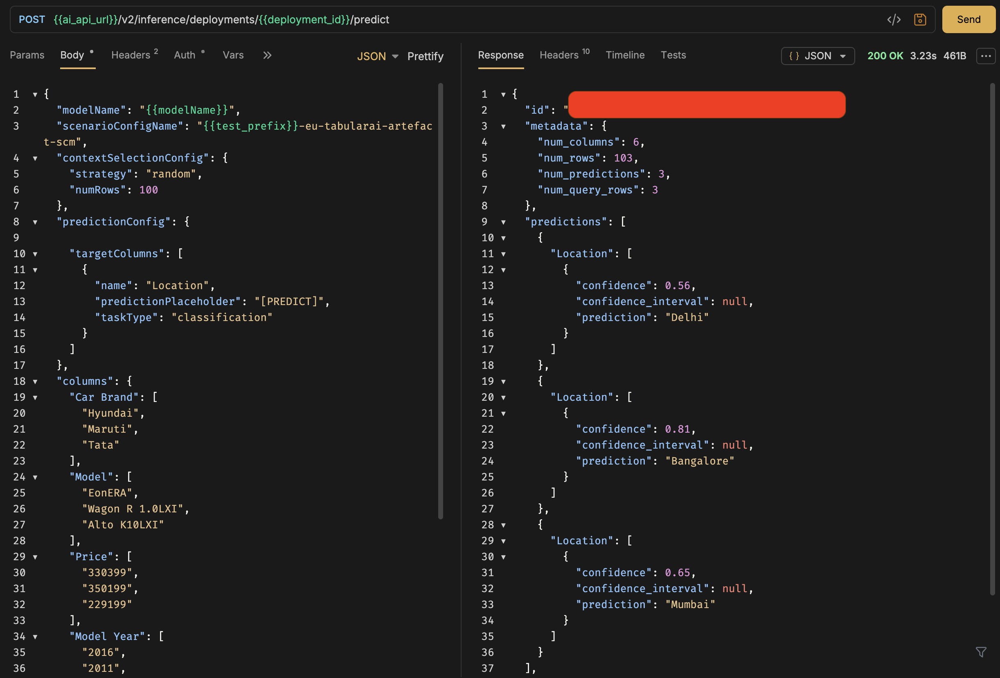

#### 3. Random strategy with a row count above the model limit (`numRows: 100000`)

```json
{
  "modelName": "{{modelName}}",
  "scenarioConfigName": "{{test_prefix}}-platform-test-scm",
  "contextSelectionConfig": {
    "strategy": "random",
    "numRows": 100000
  },
  "predictionConfig": {
    "targetColumns": [
      {
        "name": "Location",
        "predictionPlaceholder": "[PREDICT]",
        "taskType": "classification"
      }
    ]
  },
  "columns": {
    "Car Brand":  ["Hyundai", "Maruti", "Tata"],
    "Model":      ["EonERA", "Wagon R 1.0LXI", "Alto K10LXI"],
    "Price":      ["330399", "350199", "229199"],
    "Model Year": ["2016", "2011", "2011"],
    "Location":   ["[PREDICT]", "[PREDICT]", "[PREDICT]"],
    "Fuel":       ["Petrol", "Petrol", "Petrol"]
  }
}
```

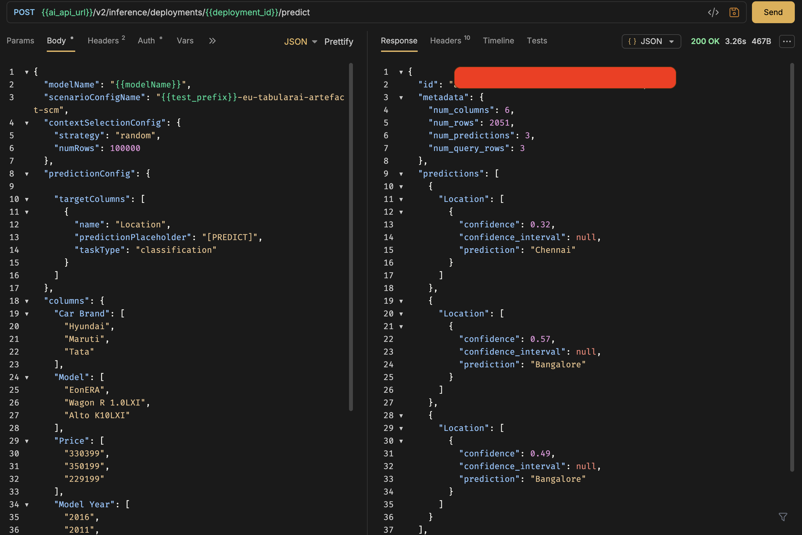

#### 4. Top-K candidate values per cell (`topK: 3`)

`topK` is a *prediction* option, not a context strategy — it returns the three most likely values for each cell instead of one.

```json
{
  "modelName": "{{modelName}}",
  "scenarioConfigName": "{{test_prefix}}-platform-test-scm",
  "predictionConfig": {
    "targetColumns": [
      {
        "name": "Location",
        "predictionPlaceholder": "[PREDICT]",
        "taskType": "classification",
        "topK": 3
      }
    ]
  },
  "columns": {
    "Car Brand":  ["Hyundai", "Maruti", "Tata"],
    "Model":      ["EonERA", "Wagon R 1.0LXI", "Alto K10LXI"],
    "Price":      ["330399", "350199", "229199"],
    "Model Year": ["2016", "2011", "2011"],
    "Location":   ["[PREDICT]", "[PREDICT]", "[PREDICT]"],
    "Fuel":       ["Petrol", "Petrol", "Petrol"]
  }
}
```

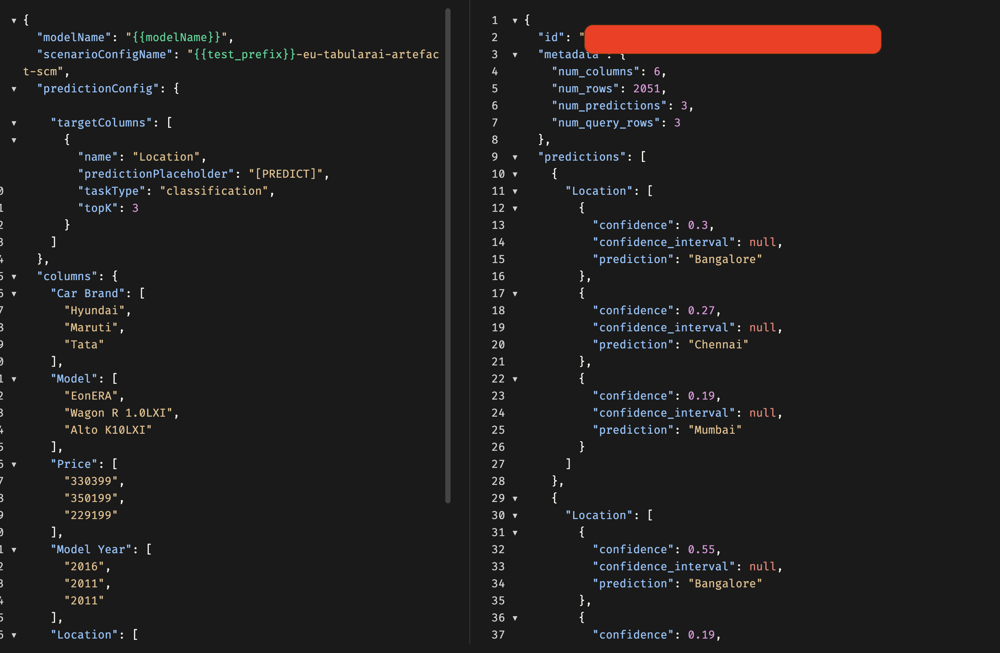

#### 5. Random strategy, all context columns known

```json
{
  "modelName": "{{modelName}}",
  "scenarioConfigName": "{{test_prefix}}-platform-test-scm",
  "contextSelectionConfig": {
    "strategy": "random"
  },
  "predictionConfig": {
    "targetColumns": [
      {
        "name": "Location",
        "predictionPlaceholder": "[PREDICT]",
        "taskType": "classification"
      }
    ]
  },
  "columns": {
    "Car Brand":  ["Hyundai", "Maruti", "Tata"],
    "Model":      ["EonERA", "Wagon R 1.0LXI", "Alto K10LXI"],
    "Price":      ["330399", "350199", "229199"],
    "Model Year": ["2016", "2011", "2011"],
    "Location":   ["[PREDICT]", "[PREDICT]", "[PREDICT]"],
    "Fuel":       ["Petrol", "Petrol", "Petrol"]
  }
}
```

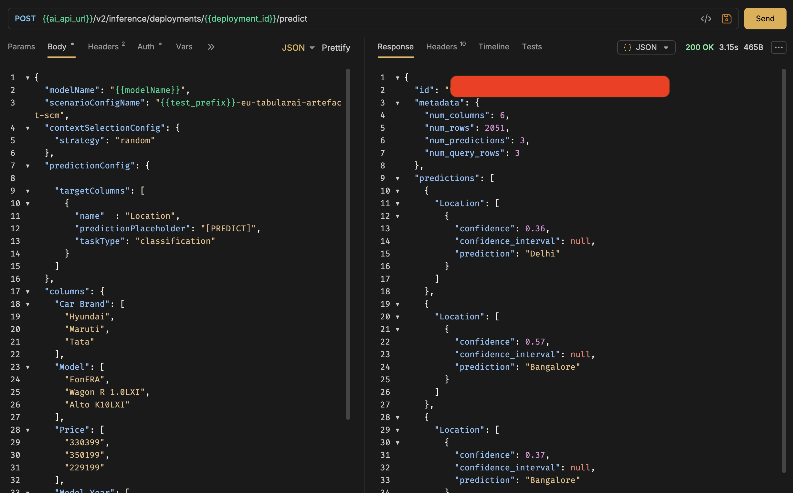

#### 6. Heuristic strategy (requires `indexColumn`)

```json
{
  "modelName": "{{modelName}}",
  "scenarioConfigName": "{{test_prefix}}-platform-test-scm",
  "contextSelectionConfig": {
    "strategy": "heuristic",
    "indexColumn": "idx"
  },
  "predictionConfig": {
    "targetColumns": [
      {
        "name": "Location",
        "predictionPlaceholder": "[PREDICT]",
        "taskType": "classification"
      }
    ]
  },
  "columns": {
    "Car Brand":  ["Hyundai", "Maruti", "Tata"],
    "Model":      ["EonERA", "Wagon R 1.0LXI", "Alto K10LXI"],
    "Price":      ["330399", "350199", "229199"],
    "Model Year": ["2016", "2011", "2011"],
    "Location":   ["[PREDICT]", "[PREDICT]", "[PREDICT]"],
    "Fuel":       ["Petrol", "Petrol", "Petrol"]
  }
}
```

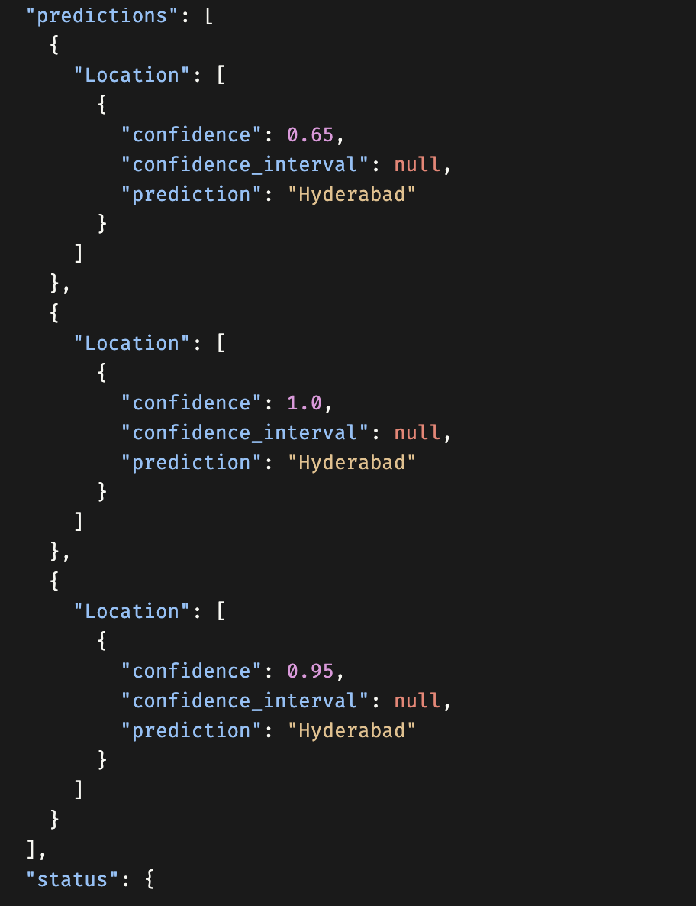

⚠️ `indexColumn` belongs inside `contextSelectionConfig`. Omitting it returns `Value error, 'indexColumn' is required when strategy is 'heuristic'`, and placing it under `predictionConfig` returns `Extra inputs are not permitted`.

#### 7. Auto strategy

```json
{
  "modelName": "{{modelName}}",
  "scenarioConfigName": "{{test_prefix}}-platform-test-scm",
  "contextSelectionConfig": {
    "strategy": "auto"
  },
  "predictionConfig": {
    "targetColumns": [
      {
        "name": "Location",
        "predictionPlaceholder": "[PREDICT]",
        "taskType": "classification"
      }
    ]
  },
  "columns": {
    "Car Brand":  ["Hyundai", "Maruti", "Tata"],
    "Model":      ["EonERA", "Wagon R 1.0LXI", "Alto K10LXI"],
    "Price":      ["330399", "350199", "229199"],
    "Model Year": ["2016", "2011", "2011"],
    "Location":   ["[PREDICT]", "[PREDICT]", "[PREDICT]"],
    "Fuel":       ["Petrol", "Petrol", "Petrol"]
  }
}
```

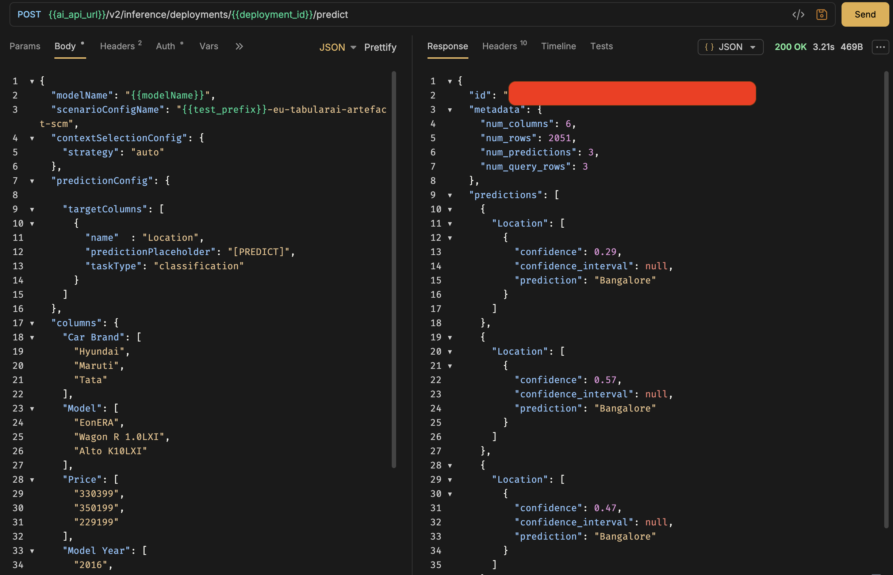

#### 8. No retrieval, with context rows supplied inline

The last two rows have a known `Location` and act as the context; the first three are the query rows.

```json
{
  "modelName": "{{modelName}}",
  "scenarioConfigName": "{{test_prefix}}-platform-test-scm",
  "contextSelectionConfig": {
    "strategy": "none"
  },
  "predictionConfig": {
    "targetColumns": [
      {
        "name": "Location",
        "predictionPlaceholder": "[PREDICT]",
        "taskType": "classification"
      }
    ]
  },
  "columns": {
    "Car Brand":  ["Hyundai", "Maruti", "Tata", "Hyundai", "Maruti"],
    "Model":      ["EonERA", "Wagon R 1.0LXI", "Alto K10LXI", "EonERA", "Wagon R 1.0LXI"],
    "Price":      ["330399", "350199", "229199", "330399", "350199"],
    "Model Year": ["2016", "2011", "2011", "2016", "2011"],
    "Location":   ["[PREDICT]", "[PREDICT]", "[PREDICT]", "Hyderabad", "Hyderabad"],
    "Fuel":       ["Petrol", "Petrol", "Petrol", "Petrol", "Petrol"]
  }
}
```

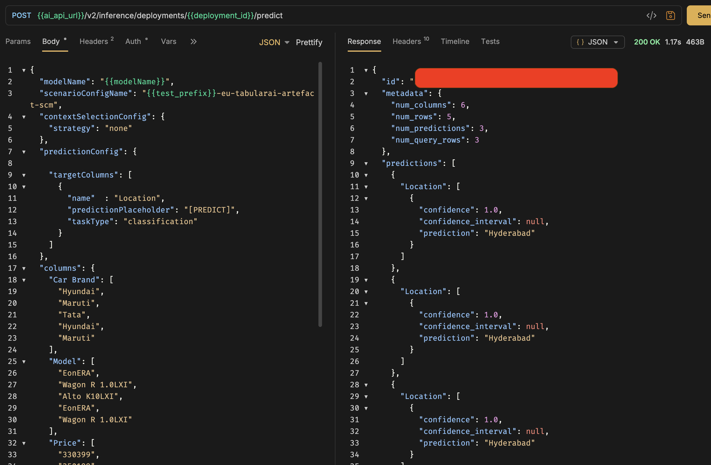

#### 9. No retrieval, without context rows — expected to fail

```json
{
  "modelName": "{{modelName}}",
  "scenarioConfigName": "{{test_prefix}}-platform-test-scm",
  "contextSelectionConfig": {
    "strategy": "none"
  },
  "predictionConfig": {
    "targetColumns": [
      {
        "name": "Location",
        "predictionPlaceholder": "[PREDICT]",
        "taskType": "classification"
      }
    ]
  },
  "columns": {
    "Car Brand":  ["Hyundai", "Maruti", "Tata"],
    "Model":      ["EonERA", "Wagon R 1.0LXI", "Alto K10LXI"],
    "Price":      ["330399", "350199", "229199"],
    "Model Year": ["2016", "2011", "2011"],
    "Location":   ["[PREDICT]", "[PREDICT]", "[PREDICT]"],
    "Fuel":       ["Petrol", "Petrol", "Petrol"]
  }
}
```

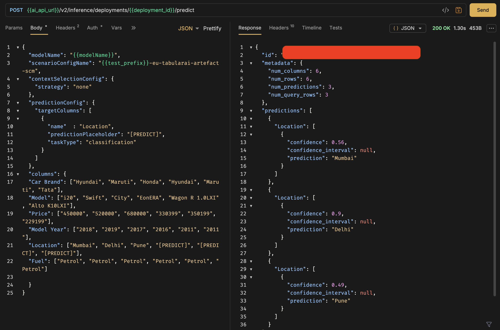

⚠️ `strategy: "none"` disables retrieval, but the tabular model still requires at least two context rows. Without them the request fails with `Not enough context rows provided. Minimum is 2.` — this is expected behaviour, not a defect.

[OPTION END]

---

### Summary

In this tutorial, you ran the complete Tabular AI flow in SAP AI Core and compared its context selection strategies:

1. **Deployed the `tabular-orchestration` scenario** — created a configuration, created a virtual deployment from it, and waited for `RUNNING` before attempting any prediction.
2. **Registered a data destination** in the Context Registry pointing at SAP HANA Data Lake Files, and read it back to confirm registration.
3. **Registered a tabular artifact** with its CSN metadata for the used-cars CSV, learning to distinguish the two failure modes at this step — a `401` subject-pattern error (certificate not authorized in HDL, needs an administrator) from a `400` path error (authorized, wrong path).
4. **Registered a scenario configuration** binding the artifact to a name that prediction requests reference.
5. **Ran predictions** with `[PREDICT]` placeholders, and learned that only columns declared in `targetColumns` are filled — a placeholder elsewhere is silently ignored.
6. **Read the response structure** — per-prediction confidence, and `metadata.num_rows` showing how many context rows were actually retrieved from the registered dataset.
7. **Swept the context selection strategies** — `random` (default, small and oversized `numRows`), `heuristic`, `auto` and `none` — plus `topK` for multiple candidate values per cell, including the two schema requirements that are easy to get wrong: `indexColumn` belongs inside `contextSelectionConfig` and is mandatory for `heuristic`, and `none` requires at least two context rows supplied inline.
8. **Compared results across strategies** — using differentiation between predictions and confidence scores, rather than any single call, to judge whether retrieval is improving prediction quality.
