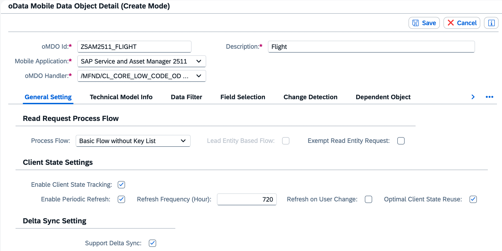
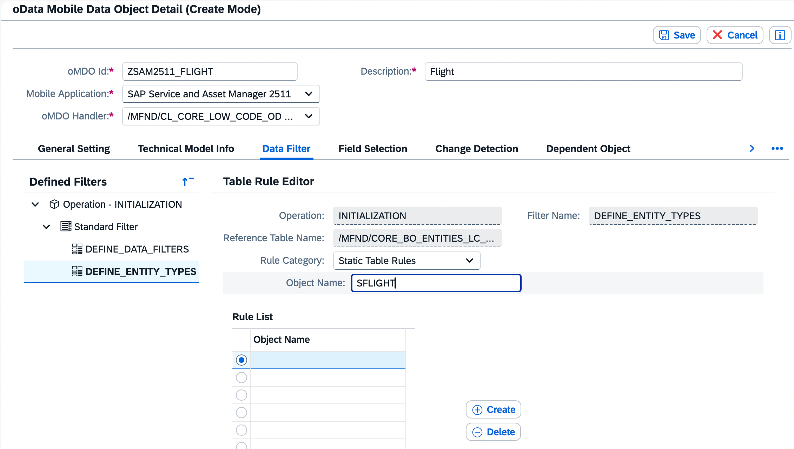
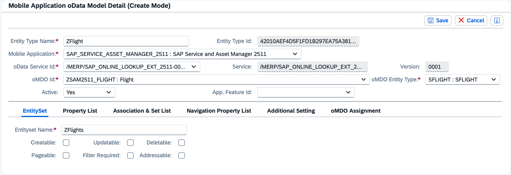
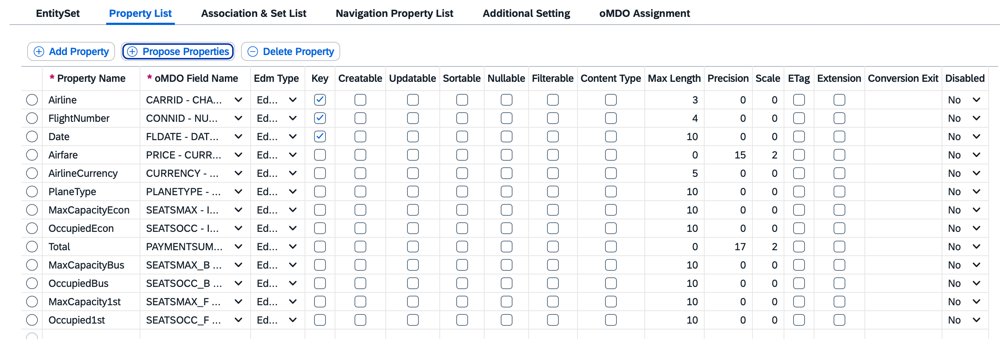
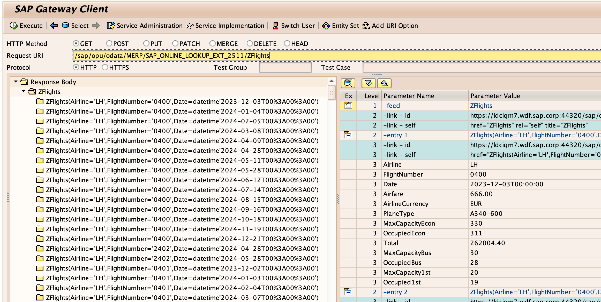
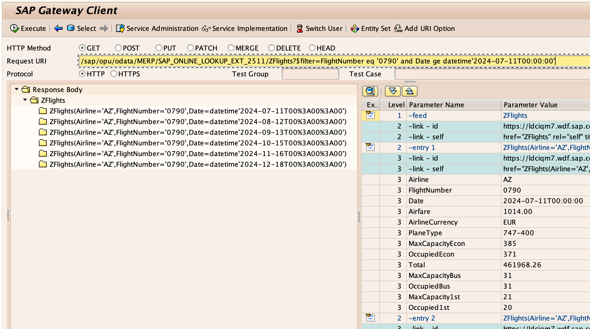
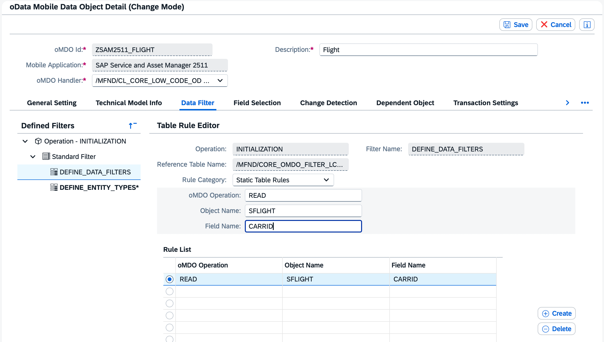
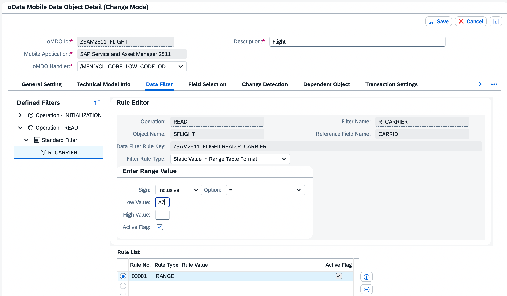
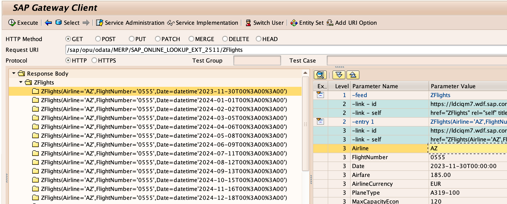

# Create Entity via MAIF Config Panel (No Code)
Create an Entity supporting input or configured data filters via the MAIF Config Panel (no code required).

## Prerequisites
- Access to the MAIF Config Panel transaction **/SYCLO/CONFIGPANEL**
- Note [3634246](https://me.sap.com/notes/3634246)

## You will learn
- How to create an Entity via the MAIF Config Panel using the MAIF Low Code Handler

## Intro
In this mission you will add an Entity to your SAP Service and Asset Manager service via the MAIF Config Panel using the MAIF Low Code Handler.

**Features**

1. Use up to 5 input filters in online requests.
Sample URI: **/sap/opu/odata/SAP_SRV_ASSET_MANAGER_2511/ZFlights?$filter=CarrId eq 'DLTA' and Date ge datetime'2024-10-15T00:00:00'**

2. Define up to 5 oMDO Data Filters.

**Use Case**

1. Offline: Expose configuration data or small data sets designed to be used with data filters only requiring periodic refresh (no exchange).

2. Online: Expose data designed to be used with input filters (data filters optional).

**Limitations**

The Low Code Handler inherits from the Basic Handler which supports the Basic Process Flow only.

1. Does not support: Exchange, Delta Calculation, or Paging

---

### Create oMDO - Specify Database Tables

The database tables are stored as a filter of the oMDO.

1. Execute transaction **/SYCLO/CONFIGPANEL** from the SAP GUI to open the MAIF Config Panel. Select **oData Mobile Data Object Configuration**. Click **Create** and enter the fields below.

    

    | Field Name | Value |
    | :--------- | ----- |
    | oMDO Id | **`ZSAM<#>_FLIGHT`** |
    | Mobile Application | **`SAP Service and Asset Manager <#>`** |
    | Description | **`Flight`** |
    | oMDO Handler | **`/MFND/CL_CORE_LOW_CODE_OD : oMDO Handler - Low Code`** |
    | Process Flow | **`Basic Flow without Key List`** |
    | Enable Client State Tracking | enabled |
    | Enable Periodic Refresh | enabled |
    | Refresh Frequency| **`720`** |
    | Optimal Client State Reuse| enabled |
    | Support Delta Sync | enabled |

2. Select the **Data Filter** tab. Expand **Operation - Initialization** > **Standard Filter** > **DEFINE_ENTITY_TYPES**. Click **Create** and enter the fields below, then click **Save**.

    

    | Field Name | Value |
    | :--------- | ----- |
    | Object Name | **`SFLIGHT`** |

### Create Entity

Note, an offline entity must be assigned to a Feature (see [Create Feature via MAIF Config Panel](https://developers.sap.com/tutorials/mob-app-mao-erp-add-feature.html)).

1. Click **ConfigPanel Home**. Select **oData Model Configuration**. Click **Create** and enter fields below.

    

    [OPTION BEGIN [Online]]

    | Field Name | Value |
    | :--------- | ----- |
    | Entity Type Name | **`ZFlight`** |
    | Mobile Application | **`SAP Service and Asset Manager <#>`** |
    | oData Service Id | **`/MERP/SAP_ONLINE_LOOKUP_EXT_<#>`** |
    | oMDO Id | **`ZSAM2511_FLIGHT`** |
    | oMDO Entity Type | **`SFLIGHT : SFLIGHT`** |
    | Entityset Name | **`ZFlights`** |
    | Active | **`Yes`** |

    [OPTION END]

    [OPTION BEGIN [Offline]]

    | Field Name | Value |
    | :--------- | ----- |
    | Entity Type Name | **`ZFlight`** |
    | Mobile Application | **`SAP Service and Asset Manager <#>`** |
    | oData Service Id | **`/MERP/SAP_SRV_ASSET_MANAGER_<#>`** |
    | oMDO Id | **`ZSAM2511_FLIGHT`** |
    | oMDO Entity Type | **`SFLIGHT : SFLIGHT`** |
    | Entityset Name | **`ZFlights`** |
    | Active | **`By Feature`** |
    | App. Feature Id | **`ZFLIGHT`** |

    [OPTION END]

2. Select **Property List** tab. Click **Propose Properties**. Click **Select All**. Deselect **Client** property. Enable **Key** for **Airline**, **FlightNumber**, and **Date** properties. Click **Accept**. Click **Save**.

    

### Test from Gateway Client

1. Execute transaction **/IWFND/GW_CLIENT** from the SAP GUI to open the Gateway Client. Open **Metadata** menu option, select **Cleanup Cache**. Enter the fields below then execute the request.

    

    | Field Name | Value |
    | :--------- | ----- |
    | Request URI | **`/sap/opu/odata/MERP/SAP_ONLINE_LOOKUP_EXT_<#>/ZFlights`** |

2. Test input filter. Enter the fields below then execute the request.

    

    | Field Name | Value |
    | :--------- | ----- |
    | Request URI | **`/sap/opu/odata/MERP/SAP_ONLINE_LOOKUP_EXT_<#>/ZFlights?$filter=FlightNumber eq '0790' and Date ge datetime'2024-07-11T00:00:00'`** |

### Add Data Filter

1. Execute transaction **/SYCLO/CONFIGPANEL** from the SAP GUI to open the MAIF Config Panel. Select **oData Mobile Data Object Configuration**. Select oMDO **ZSAM<#>_FLIGHT**. Select **Data Filter** tab. Expand **Operation - Initialization** > **Standard Filter** > **DEFINE_DATA_FILTERS**. Click **Change**. Click **Create** and enter fields below then click **Save**.

    

    | Field Name | Value |
    | :--------- | ----- |
    | oMDO Operation | **`READ`** |
    | Object Name | **`SFLIGHT`** |
    | Field Name | **`CARRID`** |

2. Expand **Operation - READ** > **Standard Filter** > **R_CARRIER**. Click **Change**. Click **Create** and enter fields below then click **Save**.

    

    | Field Name | Value |
    | :--------- | ----- |
    | Filter Rule Type | **`Static Value in Range Table Format`** |
    | Sign | **`Inclusive`** |
    | Option | **`=`** |
    | Low Value | **`AZ`** |
    
    >**NOTE**: Other Filter Rule Types are also supported.

### Test from Gateway Client

1. Execute transaction **/IWFND/GW_CLIENT** from the SAP GUI to open the Gateway Client. Enter the fields below then execute the request.

    

    | Field Name | Value |
    | :--------- | ----- |
    | Request URI | **`/sap/opu/odata/MERP/SAP_ONLINE_LOOKUP_EXT_<#>/ZFlights`** |