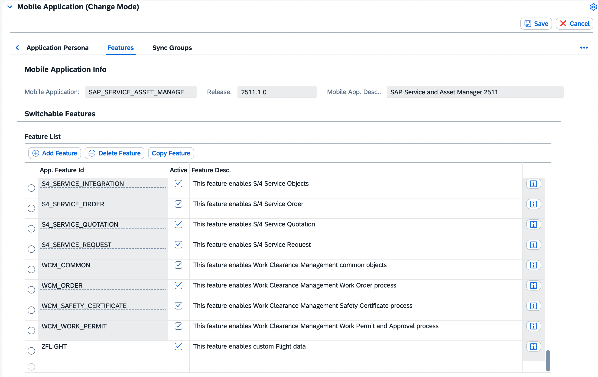
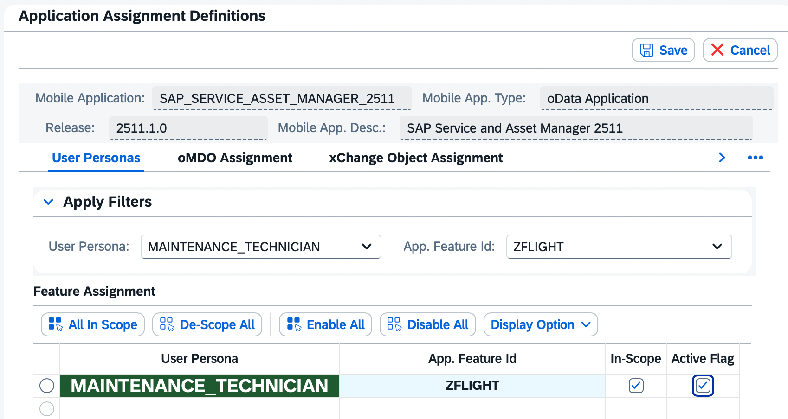
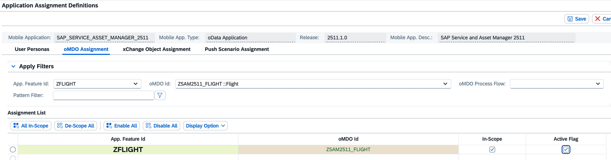
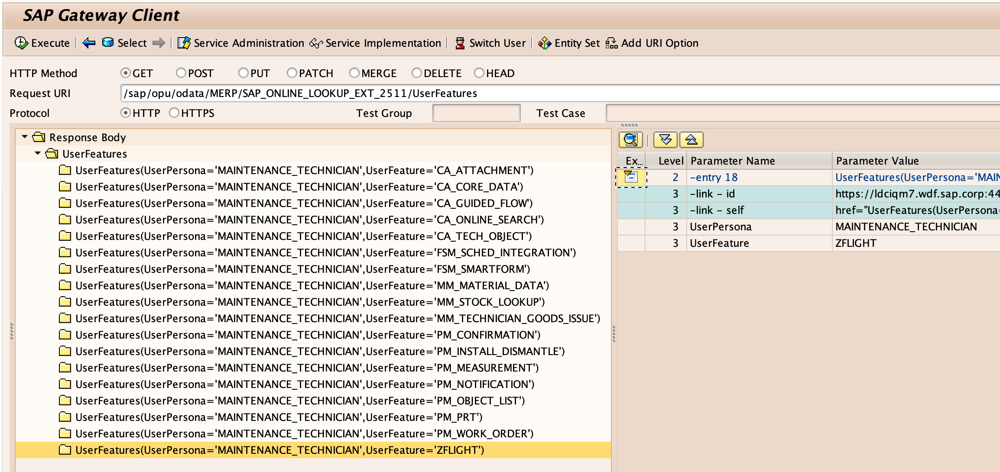

# Create Feature via MAIF Config Panel
Create, Assign, and Activate a Feature.

## Prerequisites
- Access to the MAIF Config Panel transaction **/SYCLO/CONFIGPANEL**

## You will learn
- How to create, assign, and activate a Feature

## Intro
In this mission you will create a custom feature and assign to a persona in your SAP Service and Asset Manager Service Mobile App Config via the MAIF Config Panel.

**Use Case**

1. Offline Entities must be assigned to a Feature.

---

### Create Feature

1. Execute transaction **/SYCLO/CONFIGPANEL** from the SAP GUI to open the MAIF Config Panel. Select **Mobile Application Configuration**. Select your Mobile App, click **Features** tab, then click **Change**. Click **Add Feature** and enter fields below, then click **Save**.

    

    | Field Name | Value |
    | :--------- | ----- |
    | App. Feature Id | **`ZFLIGHT`** |
    | Active | enabled |
    | Feature Desc. | **`This feature enables custom Flight data`** |

### Assign Feature to Persona

1. Click **ConfigPanel Home**. Select **Component Assignments**. Select your mobile app. Filter by the fields below. Click **Change** and enable fields below, then click **Save**.

    

    | Field Name | Value |
    | :--------- | ----- |
    | User Persona | **`MAINTENANCE_TECHNICIAN`** |
    | App. Feature Id | **`ZFLIGHT`** |
    | In-Scope | enabled |
    | Active Flag | enabled |

### Assign oMDO to Feature

This step is required once you have created an oMDO which you would like to use to retrieve data in the offline scenario (see the **Create oMDO** step of [Create an Entity via MAIF Config Panel (No Code)](https://developers.sap.com/tutorials/mob-app-mao-erp-add-entity-no-code.html)).

1. Click **ConfigPanel Home**. Select **Component Assignments**. Select your mobile app. Click **oMDO Assignments**. Filter by the fields below. Click **Change** and enable fields below, then click **Save**.

    

    | Field Name | Value |
    | :--------- | ----- |
    | App. Feature Id | **`ZFLIGHT`** |
    | oMDO Id | **`ZSAM<#>_FLIGHT`** |
    | In-Scope | enabled |
    | Active Flag | enabled |

### Test from Gateway Client

1. Execute transaction **/IWFND/GW_CLIENT** from the SAP GUI to open the Gateway Client. Enter the fields below then execute the request. You should see feature `ZFLIGHT` in the response. Ensure test user has Maintenance Technician persona assigned.

    

    | Field Name | Value |
    | :--------- | ----- |
    | Request URI | **`/sap/opu/odata/MERP/SAP_ONLINE_LOOKUP_EXT_<#>/UserFeatures`** |