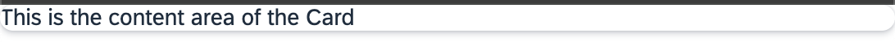
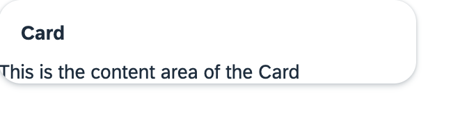
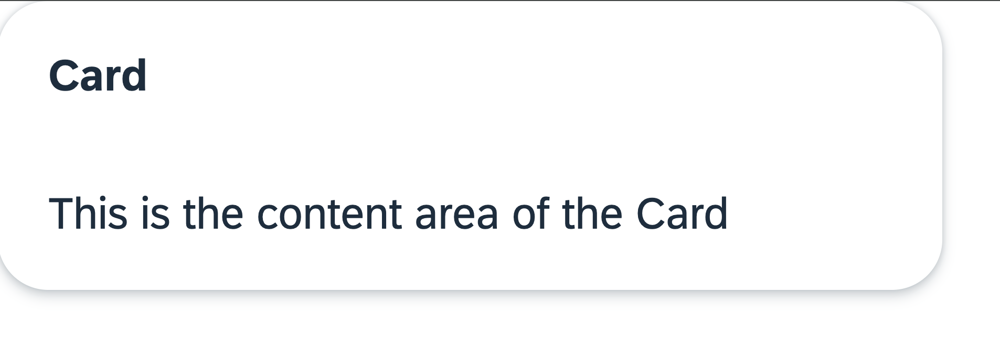

# Create a Card Component
<!-- description --> Define your first component using UI5 Web Components for React.

## You will learn
-  How to import UI5 Web Components into your application
-  Learn about the usage of props
-  How to use event handling


## Intro
You will now integrate the first UI5 Web Component into your App. You can find **all** available UI5 Web Components for React in the [Storybook](https://sap.github.io/ui5-webcomponents-react).
There you can try out the different components and also take a look at the coding and the available props.

---

### Add the Card component to MyApp.tsx

First you need to import the components you want to use.

You can check out all available components in the [Storybook](https://sap.github.io/ui5-webcomponents-react). Take your time to play around a little, change some `props` and take a look at the coding.

1. Start with importing a `Card` component into your `MyApp.tsx` file.

    ```TypeScript / TSX
    import { Card } from "@ui5/webcomponents-react";
    ```

2. Now it's time to use the `Card` component. Replace the content of your `MyApp` function with the following code.

    ```TypeScript / TSX
    return (
      <div>
        <Card>This is the content area of the Card</Card>
      </div>
    );  
    ```

    > For now, the `Card` only contains some text as `children`, but in the [Storybook](https://sap.github.io/ui5-webcomponents-react/?path=/story/4-ui5-web-components-card--default-story), you can see that a `Card` can receive many props.

    Your webpage should now look like this:

    

    Your `MyApp.tsx` file should now look like this :

    ```TypeScript / TSX
    import { Card } from "@ui5/webcomponents-react";

    export function MyApp() {
      return (
        <div>
          <Card>This is the content area of the Card</Card>
        </div>
      );
    }
    ```

### Add content to the Card component

The heading area of the `Card` component is empty, this is because it didn't receive the `header` prop. The `header` prop itself expects another component, the `CardHeader`.

1. Import the `CardHeader`.

   ```TypeScript / TSX
   import { Card, CardHeader } from "@ui5/webcomponents-react";
   ```

2. Add the `CardHeader` component to your `Card` and give it a title by setting the `titleText` prop:

   ```TypeScript / TSX
   <div>
     <Card header={<CardHeader titleText="Card" />}>
       This is the content area of the Card
     </Card>
   </div>
   ```

3. Our application already applies the SAP defined `font-family` for all texts that don't implement `font-family` themselves via the `index.css` file, which is why the inner text already has the right font. However, to enable this on a single text without using CSS, you can use the `Text` component. Let's wrap the text content of the `Card` inside the `Text` component:

   ```TypeScript / TSX
   import { Card, CardHeader, Text } from "@ui5/webcomponents-react";
   ```

   ```TypeScript / TSX
   <div>
     <Card header={<CardHeader titleText="Card" />}>
       <Text>This is the content area of the Card</Text>
     </Card>
   </div>
   ```

### Style your component

In this step, we will only apply [inline-styling](https://reactjs.org/docs/dom-elements.html#style). You can also style your component using CSS ([modules](https://github.com/css-modules/css-modules)), but this and many more information regarding the styling approach of UI5 Web Components (for React) will be covered in [chapter six](ui5-webcomponents-react-styling) of the tutorial series.

The `Card` currently spreads across the whole screen, this behavior is intended, so it takes up the whole space of its container.

1. To restrict the `width` of the `Card`, add the `style` prop.

   ```TypeScript / TSX
   <Card header={<CardHeader titleText="Card" />} style={{ width: "300px" }}>
     <Text>This is the content area of the Card</Text>
   </Card>
   ```

    

2. The content of the card is way too close to the border of the `Card`, so a `padding` is needed. You can define your own spacing, or use the standard SAP spacing variables. In this example we're using one of the global [CSS Variables](https://developer.mozilla.org/en-US/docs/Web/CSS/CSS_cascading_variables/Using_CSS_custom_properties) from the [theming-base-content](https://github.com/SAP/theming-base-content) repo, which are already included when using UI5 Web Components.
    
    The CSS var in question is `--sapContent_Space_S` (`1rem`) and we're going to apply it via inline-style again:
    
   ```TypeScript / TSX
    <Text style={{padding: "var(--sapContent_Space_S)"}}>
      This is the content area of the Card
    </Text>
   ```

    Hereby you get a standardized content-padding.

    After this step `MyApp.tsx` should look like this:

   ```TypeScript / TSX
   import { Card, CardHeader, Text } from "@ui5/webcomponents-react";

   export function MyApp() {
   return (
     <div>
       <Card header={<CardHeader titleText="Card" />} style={{ width: "300px" }}>
         <Text style={{ padding: "var(--sapContent_Space_S)" }}>
           This is the content area of the Card
         </Text>
        </Card>
     </div>
    );
   }
   ```

    Your application should look like this:

    


### Event handling


1. The `Card` header can also be interactive, to enable this set `interactive` to `true`.

   ```TypeScript / TSX
   <Card
     header={<CardHeader titleText="Card" interactive />}
     ...
   </Card>
   ```

    > We didn't pass a value to `interactive`, because it [defaults to true](https://reactjs.org/docs/jsx-in-depth.html#props-default-to-true) if the value is omitted.
    
    When you now click or focus the header, the appropriate styles are applied, so users know they can interact with it.     
   
2. To make the header react to a click (or SPACE/ENTER press), add a function as value to the `onClick` prop.

   ```TypeScript / TSX
   <Card
     header={
       <CardHeader
         titleText="Card"
         interactive
         onClick={handleHeaderClick}
       />
     }
     style={{ width: "300px" }}
   >
     ...
   </Card>
   ```

3. Now, add the callback function right in the beginning of the component (definition function):

   ```TypeScript / TSX
   export function MyApp() {
     const handleHeaderClick = () => {
       alert("Header clicked");
   };
   ...
   ```

    The file should now look like this:

    ```TypeScript / TSX
    import { Card, CardHeader, Text } from "@ui5/webcomponents-react";

    export function MyApp() {
      const handleHeaderClick = () => {
        alert("Header clicked");
      };
      return (
        <div>
          <Card
            header={
              <CardHeader
                titleText="Card"
                interactive
                onClick={handleHeaderClick}
              />
            }
            style={{ width: "300px" }}
          >
            <Text style={{ padding: "var(--sapContent_Space_S)" }}>
              This is the content area of the Card
            </Text>
          </Card>
        </div>
      );
    }
    ```

    Now the header opens an alert box on click.


---
